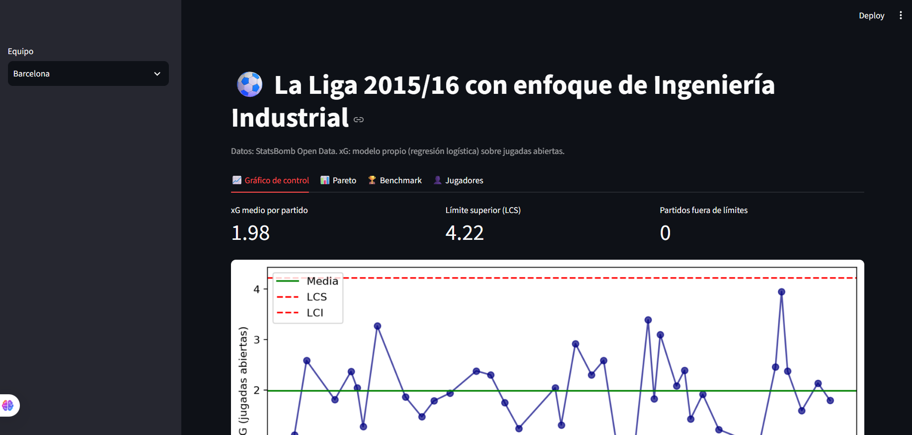
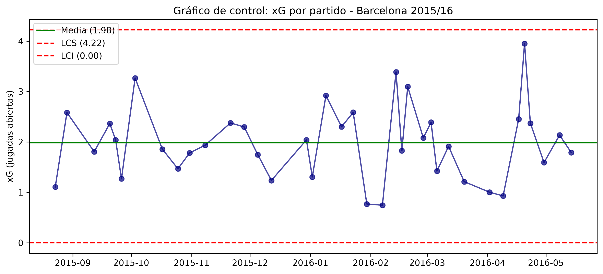
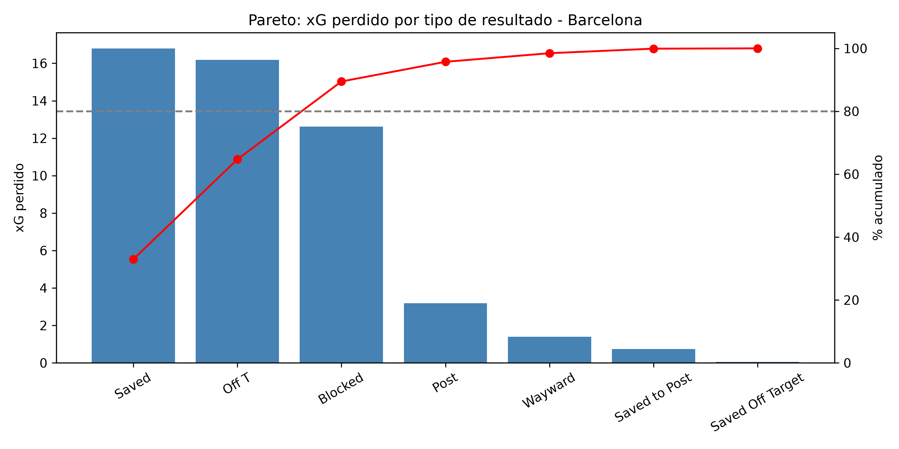
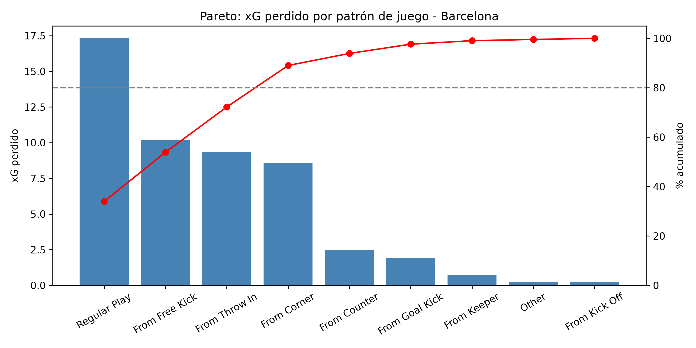
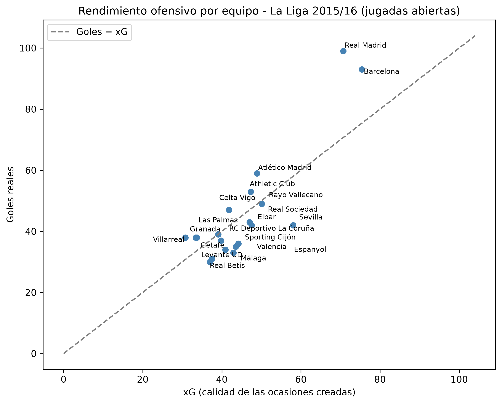
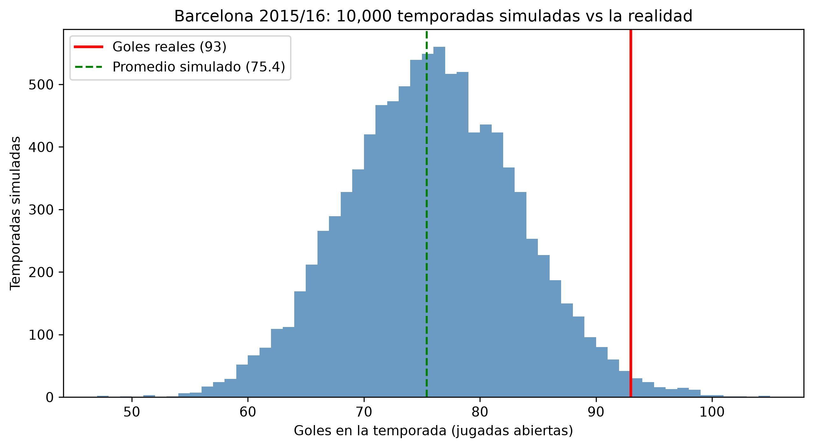
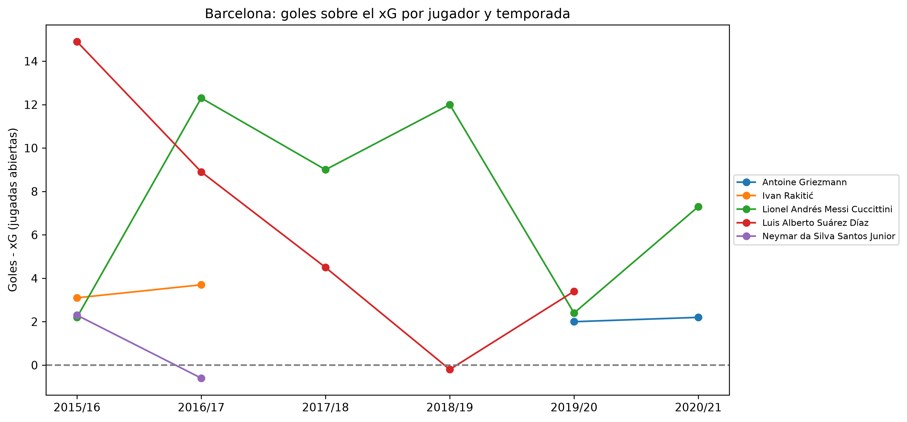

# ⚽ Fútbol + Ingeniería Industrial: calidad, variabilidad y persistencia del rendimiento en La Liga

Proyecto personal que aplica herramientas clásicas de la **Ingeniería Industrial y Six Sigma** (gráficos de control, diagramas de Pareto, benchmarking, simulación Monte Carlo y el ciclo DMAIC) al análisis de datos de fútbol, usando un **modelo propio de goles esperados (xG)**. Incluye un análisis de toda La Liga 2015/16 y un estudio de **persistencia** del Barcelona a lo largo de seis temporadas.



## ¿Qué preguntas responde?

1. ¿El rendimiento ofensivo de un equipo es un proceso **estable**?
2. ¿**Dónde** se pierde valor?
3. ¿Cómo se compara con el resto de la liga?
4. ¿Un rendimiento superior es **suerte o capacidad real**, y se **sostiene en el tiempo**?

Tratamos cada partido como la salida de un **proceso** y cada tiro como una **unidad producida**, con una "calidad" medida por su probabilidad de gol (xG).

## Metodología (enfoque DMAIC)

| Fase | Qué se hizo | Script |
|---|---|---|
| **Define** | Definir el problema: calidad de ocasiones y aprovechamiento ofensivo | — |
| **Measure** | Descarga de tiros y modelo xG propio (regresión logística con distancia, ángulo y remate de cabeza) sobre jugadas abiertas | `02`, `05`, `13`, `14` |
| **Analyze** | Gráfico de control, Pareto, benchmarking y análisis por jugador | `06`, `07`, `08`, `10` |
| **Improve** | Simulación Monte Carlo (10,000 temporadas) para separar suerte de rendimiento real | `09`, `16` |
| **Control** | Dashboard interactivo y verificación de persistencia en seis temporadas | `app.py`, `15` |

## Resultados principales

### Parte I: La Liga 2015/16 (temporada completa, 380 partidos y 9,168 tiros)

**1. Modelo xG propio, validado contra un estándar profesional.** Evaluado en tiros que el modelo no vio, y comparado con el xG de StatsBomb:

| Métrica | Propio (2015/16, 30 % reservado) | StatsBomb | Propio (2018/19, entrenado en 2015/16) | StatsBomb |
|---|---|---|---|---|
| AUC (mayor es mejor) | 0.794 | 0.833 | 0.742 | 0.779 |
| Brier (menor es mejor) | 0.0849 | 0.0771 | 0.0927 | 0.0876 |

El modelo propio queda algo por debajo de StatsBomb en ambas pruebas, con una brecha similar, porque StatsBomb usa información que aquí no está (posición del portero y de los defensores).

**2. Gráfico de control (Barcelona 2015/16).** El xG por partido tuvo una media de 1.98 y **ningún partido fuera de los límites de control**: las subidas y bajadas fueron variación normal. Reaccionar a una mala racha aislada habría sido sobreajustar el proceso.



**3. Pareto del xG perdido (Barcelona).** Tiros atajados (33 %), desviados (32 %) y bloqueados (25 %) explican cerca del 90 % del xG perdido. Por patrón de juego, la jugada normal pesa 34 % y las reanudaciones (tiro libre, saque de banda y córner) suman otro 55 %.




El Pareto mide volumen, no eficiencia: el Barcelona tuvo 20.0 % de tiros bloqueados frente al 22.7 % promedio de la liga, es decir, mejor que la media.

**4. Benchmarking de los 20 equipos.** Real Madrid (99 goles con 70.7 de xG) y Barcelona (93 con 75.4) rindieron muy por encima de lo esperado; Sevilla (42 con 58.0) quedó muy por debajo.



**5. Monte Carlo.** Simulando cada temporada 10,000 veces según el xG de cada tiro, 3 de 20 equipos quedaron fuera del rango normal del 95 % (Real Madrid y Barcelona por encima, Sevilla por debajo). Por azar puro se esperaría aproximadamente 1.



**6. Jugadores (exploratorio, una sola temporada).** Suárez (+15 goles sobre su xG) y Bale (+11) destacaban en 2015/16. Una sola temporada no permite distinguir habilidad de racha, y la Parte II lo pone a prueba.

### Parte II: ¿Se sostiene en el tiempo? Barcelona, 2015/16 a 2020/21

Se descargaron los tiros de los partidos del Barcelona de seis temporadas y se aplicó el mismo modelo xG, entrenado una sola vez con 2015/16. Solo jugadas abiertas.

| Temporada | Goles | xG | Diferencia | % de simulaciones de pura suerte que igualan los goles reales |
|---|---|---|---|---|
| 2015/16 | 93 | 76.0 | +17.0 | 1.5 % |
| 2016/17 | 91 | 67.1 | +23.9 | 0.07 % |
| 2017/18 | 82 | 66.7 | +15.3 | 1.7 % |
| 2018/19 | 67 | 52.0 | +15.0 | 1.3 % |
| 2019/20 | 59 | 45.8 | +13.2 | 2.0 % |
| 2020/21 | 69 | 62.6 | +6.4 | 19.1 % |
| **Las seis juntas** | **461** | **370.2** | **+90.8** | **0 de 10,000** |

- **El equipo superó su xG en las seis temporadas.** Con las seis juntas, ninguna de las 10,000 temporadas simuladas llegó a 461 goles (rango normal del 95 %: 338 a 403). El xG de StatsBomb, que sí ve el contexto de cada tiro, también queda por debajo de los goles reales en las seis temporadas.
- **Messi** superó su xG en las seis temporadas (139 goles con 93.7 esperados; rango normal de 78 a 111; 0 de 10,000 simulaciones lo igualan). Dos de sus temporadas (2015/16 y 2019/20) caben en el azar; las de 2016/17 y 2018/19 son extremadamente difíciles de explicar por suerte.
- **Suárez** (499 tiros, hasta 2019/20): +31 goles sobre su xG en total (1 de 10,000 simulaciones lo iguala), pero concentrados al inicio: +14.9 en 2015/16 y +8.9 en 2016/17, y luego valores compatibles con la suerte.
- **Rakitić, Neymar y Griezmann** tienen muy pocos tiros por temporada y sus diferencias están dentro del ruido.



**Nota metodológica.** Con solo 2015/16, Suárez parecía un finalizador de élite excepcional. Al ampliar a seis temporadas se vio que ese nivel no se mantuvo: es un ejemplo de regresión a la media, y muestra por qué una sola temporada no basta para concluir.

**Qué se puede y qué no se puede afirmar.** Se puede afirmar que el Barcelona y Messi superaron de forma sostenida lo que un modelo simple de xG esperaba; es muy improbable que sea solo suerte. **No** se puede afirmar el motivo: puede ser mejor finalización, o que el equipo genere ocasiones más fáciles de lo que la distancia y el ángulo muestran (espacio libre, mano a mano, calidad del pase previo), algo que este modelo no ve.

## Limitaciones

- En 2015/16 los datos abiertos cubren toda la liga; en las demás temporadas solo hay partidos del Barcelona, y no todos (entre 33 y 36 de 38). Por eso el benchmarking de 20 equipos solo es válido para 2015/16.
- El modelo usa solo distancia, ángulo y remate de cabeza, y **no ve** la posición del portero ni de los defensores, ni la calidad del pase previo.
- Solo jugadas abiertas (sin penales ni tiros libres directos).
- La simulación supone que los tiros son independientes entre sí.
- Algunos jugadores tienen pocos tiros por temporada (alrededor de 40 a 70), por lo que sus diferencias son poco fiables.
- La persistencia se estudió en un único equipo; no se puede generalizar a otros.
- El xG mide tiros, no la creación de juego (pases, asistencias).

## Cómo reproducirlo

Los datos **no se incluyen en este repositorio**: se descargan con los scripts.

```bash
pip install -r requirements.txt
```

**Parte I (La Liga 2015/16):**

```bash
python 02_descargar_tiros.py     # con TEMPORADAS = [27]
python 05_modelo_xg.py
python 11_guardar_fechas.py      # season_id=27
streamlit run app.py
```

Los scripts `03`, `04`, `06`, `07`, `08`, `09` y `10` son los análisis individuales. Los scripts `06` y `11` llevan un `season_id` en el código (27 = 2015/16) y los títulos de los gráficos se ajustan a mano según la temporada.

**Parte II (Barcelona, seis temporadas):** copia el archivo `data/tiros_laliga.csv` generado en la Parte I a `data/respaldo_2015_16/tiros_laliga.csv` (con él se entrena el modelo) y ejecuta:

```bash
python 14_descargar_temporadas.py
python 15_persistencia_jugadores.py
python 16_montecarlo_temporadas.py
```

El script `13` (valida el modelo entrenado en 2015/16 sobre otra temporada) es de validación.

## Tecnologías
Python · pandas · NumPy · scikit-learn · matplotlib · mplsoccer · Streamlit · statsbombpy

## Datos


Datos: [StatsBomb Open Data](https://github.com/hudl/open-data). Proyecto personal con fines educativos, sin afiliación con StatsBomb.

## Autor

Mijael Blancos Chicalla · Estudiante de Ingeniería Industrial · blancosmijael66@gmail.com
